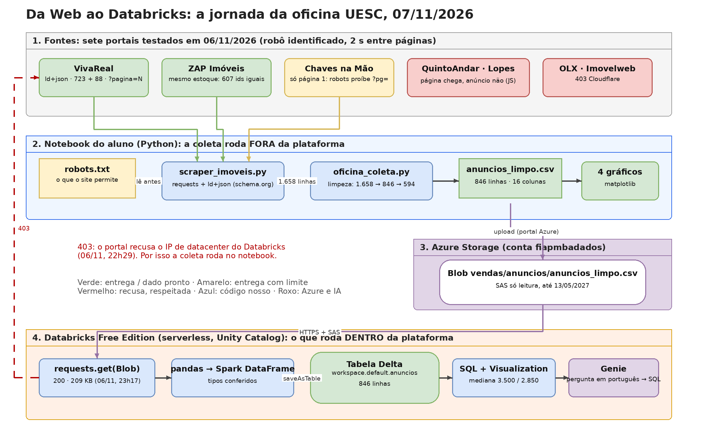

# Da Web ao Databricks: oficina UESC, 07/11/2026

**Evento:** Estatística e IA na Prática, Universidade Estadual de Santa Cruz (Ilhéus/BA), Laboratório LEC.
**Professor:** Rafael Santos Novo Pereira (PEERS Consulting + Technology; docente FIAP, Senac e ETEC). Apoio: FIAP.
**Palestra de 06/11:** "Da Web aos Dados: web scraping, Estatística e a construção de bases para análise".

A pergunta da oficina: **quanto custa alugar em Ilhéus e em Itabuna, segundo o que está anunciado hoje?**
O caminho: coletar anúncios de portais de imóveis com um robô honesto, limpar a base, colocá-la num Azure Blob, carregá-la como tabela Delta no Databricks Free Edition, responder em SQL e em português (Genie).



## Comece por aqui

| Você quer... | Abra |
|---|---|
| Fazer a oficina do zero, passo a passo | [`docs/01_Passo_a_Passo_Alunos.md`](docs/01_Passo_a_Passo_Alunos.md) |
| Entender web scraping, robots.txt e por que a base engana | [`docs/02_Web_Scraping_Explicado.md`](docs/02_Web_Scraping_Explicado.md) |
| Entender o Databricks, a conta, o Blob e o Genie | [`docs/03_Databricks_Jornada.md`](docs/03_Databricks_Jornada.md) |
| Ver os slides | [`docs/Oficina_Da_Web_ao_Databricks_UESC_2026.pdf`](docs/Oficina_Da_Web_ao_Databricks_UESC_2026.pdf) |
| Editar o diagrama | [`docs/diagrama_jornada.drawio`](docs/diagrama_jornada.drawio) (abra em app.diagrams.net) |

## Estrutura

```
.
├── README.md
├── coleta/                      roda no SEU computador (Python 3.10+)
│   ├── scraper_imoveis.py       coletor: VivaReal, ZAP e Chaves na Mão, comentado linha a linha
│   ├── oficina_coleta.py        um comando: coleta, limpeza, resumo na tela, CSV e 4 gráficos
│   ├── comparar_fontes.py       teste dos portais (o que cada um entrega a um programa)
│   ├── rodar_coleta.bat         Windows: dois cliques instala e roda
│   └── requirements.txt
├── databricks/                  roda DENTRO do Databricks Free Edition
│   ├── blob_para_databricks.py  notebook: Blob -> pandas -> tabela Delta (4 células)
│   ├── oficina_sql_notebook.sql notebook SQL: 8 consultas com resultado esperado
│   └── scraper_databricks_notebook.py  célula 1 = a prova do 403 (o portal recusa o Databricks)
├── dados/                       resultado da coleta de 06/11/2026
│   ├── anuncios_limpo.csv       846 anúncios únicos, 16 colunas
│   ├── saida_coleta.txt         a tela completa da execução
│   └── g1..g4_*.png             histograma, bairros, preço x área, tipos
└── docs/
    ├── 00_Roteiro_do_Professor_60min.md
    ├── 01_Passo_a_Passo_Alunos.md
    ├── 02_Web_Scraping_Explicado.md
    ├── 03_Databricks_Jornada.md
    ├── diagrama_jornada.drawio / .png
    ├── Oficina_Da_Web_ao_Databricks_UESC_2026.pdf
    └── prints/                  telas reais do Databricks e das fontes
```

## Rodar em 3 comandos

```bash
cd coleta
python -m pip install -r requirements.txt
python oficina_coleta.py --rapido        # 50 s; sem --rapido, coleta completa em ~3 min
```

Depois, no Databricks: a célula única do passo 7 em `docs/01_Passo_a_Passo_Alunos.md` cria `workspace.default.anuncios` lendo o CSV do Blob. Ninguém precisa fazer upload.

## O que os dados mostraram (06/11/2026, 23h38 a 23h44)

- 7 portais testados, 3 entregam (VivaReal, ZAP, Chaves na Mão), 4 recusam ou não permitem (QuintoAndar, Lopes, OLX, Imovelweb). A recusa foi respeitada.
- 1.658 linhas coletadas em 196 s → 846 anúncios únicos → 594 residenciais.
- Ilhéus: mediana **R$ 3.500** (n = 542), R$ 40/m². Itabuna: mediana **R$ 2.850** (n = 52), R$ 18,6/m².
- Pela média bruta (com galpões), Itabuna parecia mais cara. Pela mediana residencial, é R$ 650 mais barata. Quatro decisões de limpeza mudaram o número; nenhuma delas é "estatística de prova".

## Regras do robô (e desta oficina)

Identifica-se no User-Agent; espera 2 s entre páginas; para se o site responder 403 ou 429; coleta só atributos do imóvel, nada do anunciante; respeita o `robots.txt` (por isso o Chaves na Mão entra só com a página 1); não se disfarça de humano; uso educacional, sem redistribuição dos dados.

## Avisos

- O notebook do Blob contém um **SAS de leitura** do container `vendas`, válido até 13/05/2027. Ele dá leitura a quem tiver o link. Os dados são anúncios públicos e material de aula; mesmo assim, não reutilize o SAS fora da oficina.
- Os números mudam todo dia: o portal publica e remove anúncios. Compare sempre com a coluna `coletado_em`.
- O que não foi verificado antes da oficina está listado no fim de cada documento. Quando algo não pôde ser verificado, está escrito, em vez de preenchido.

## Fontes

- VivaReal, ZAP Imóveis, Chaves na Mão: páginas de busca de aluguel e `robots.txt`, lidos em 06/11/2026.
- Databricks: documentação do Free Edition (recursos e limitações) e do Genie, docs.databricks.com, lidas em 05 e 06/11/2026; testes na conta do professor em 06/11/2026 (VivaReal 403 às 22h29; Azure Blob 200 às 23h17; tabela de 846 linhas às 23h59).
- LGPD: Lei 13.709/2018, art. 5º, I e art. 7º, §4º (planalto.gov.br).
- Salários de engenharia de dados (slide de abertura): Portal Salário, "Engenheiro de Dados, CBO 2122-05", dados do CAGED, atualizado em 05/11/2026; Numerando, "Quanto ganha um Engenheiro de Dados", Novo CAGED, referência 2026-03. Vagas PEERS: peers.inhire.app/vagas, 07/11/2026.
- Leituras: Armbrust et al. (CIDR 2021; VLDB 2020); Krotov, Johnson e Silva (2020); Salganik (2018); Landers et al. (2016).
