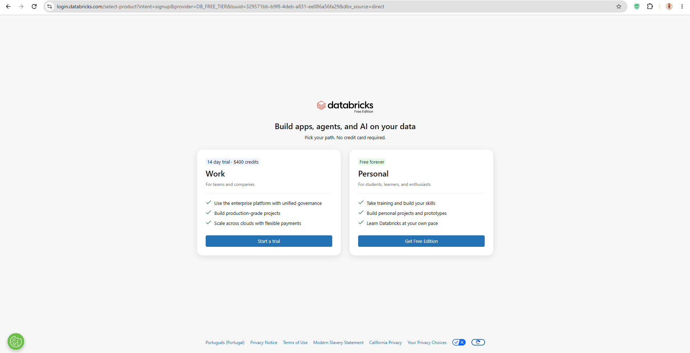
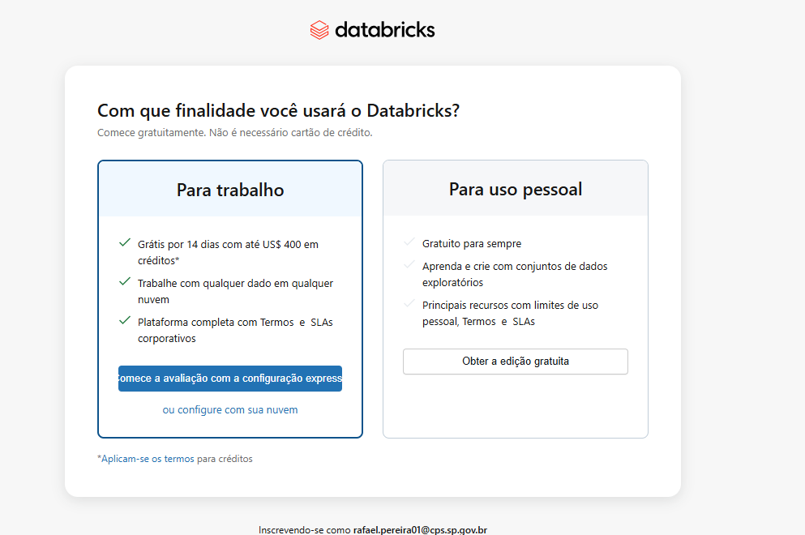
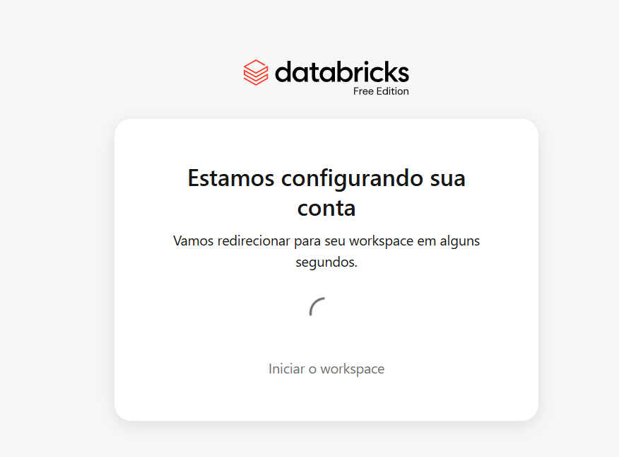
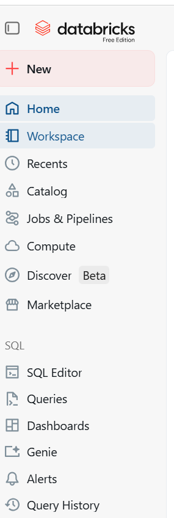
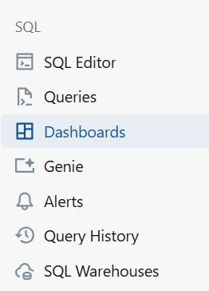
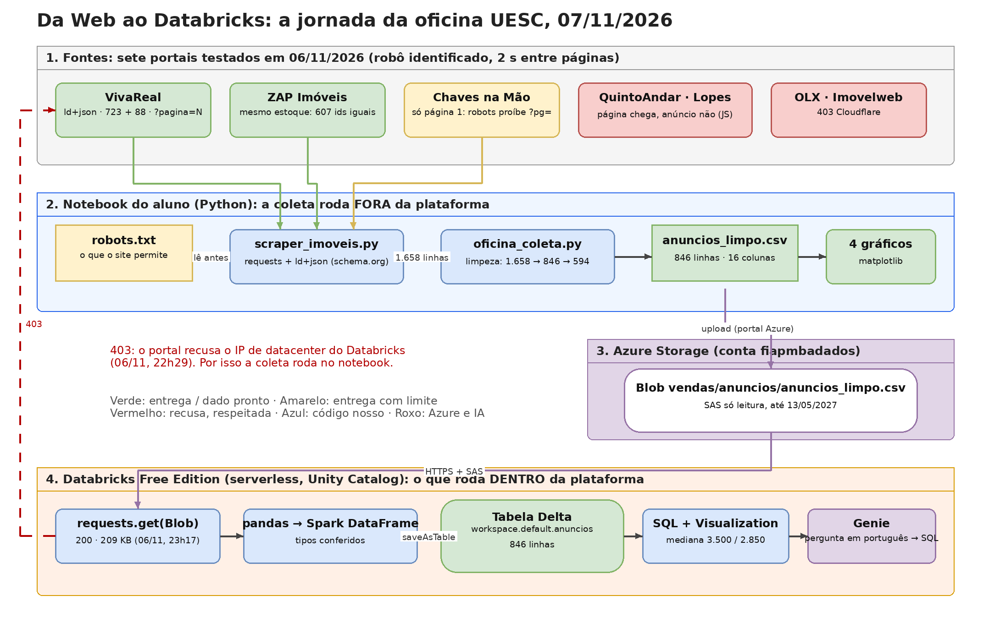
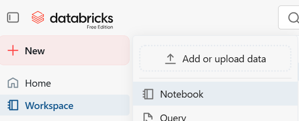
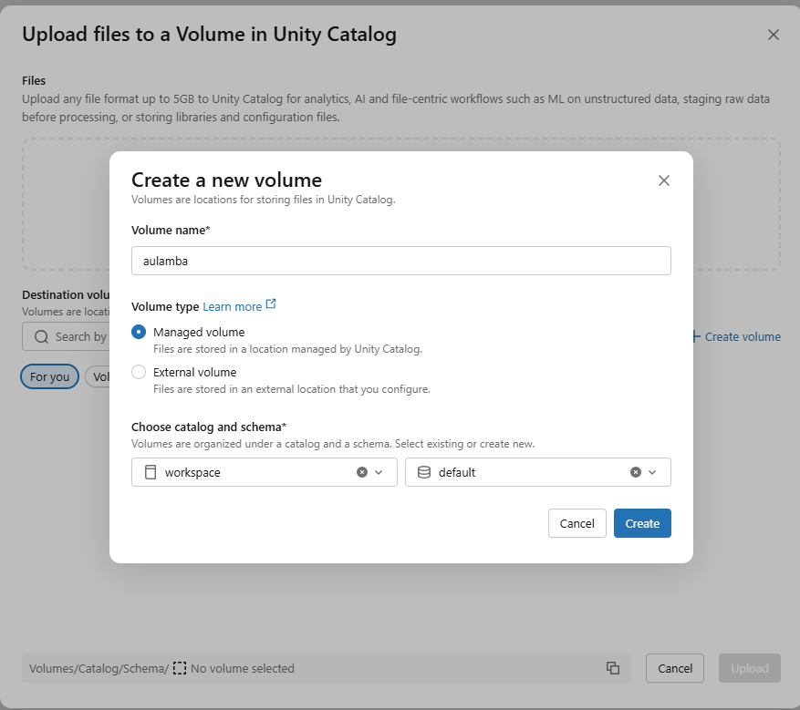
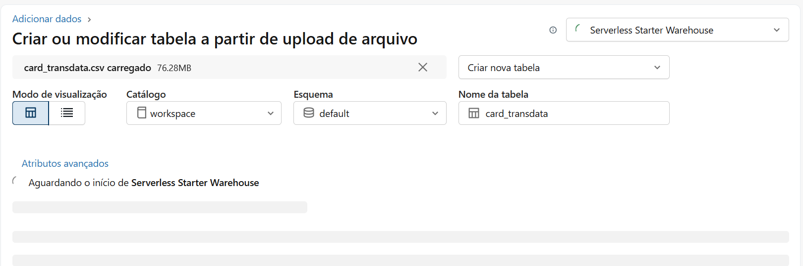

# Databricks: o que é, como funciona e a jornada que fizemos

Material da oficina "Da Web ao Databricks", UESC, 07/11/2026. Prof. Rafael Santos Novo Pereira.
As capturas de tela em `docs/prints/` são reais, tiradas da conta do professor (Free Edition, 2026).

---

## 1. Revisão em cinco frases

1. **Databricks** é uma plataforma de dados e IA na nuvem, criada em 2013 pelos criadores do **Apache Spark** (UC Berkeley).
2. **Spark** é um motor que divide o processamento entre muitas máquinas ao mesmo tempo e trabalha em memória. A analogia da aula: 100 estagiários organizando planilhas em paralelo, em vez de um só.
3. **Lakehouse** é a ideia que a Databricks popularizou: guardar os dados como arquivos baratos na nuvem (como um data lake) e, por cima, dar a eles o que um data warehouse tem: tabelas com transação, histórico e governança.
4. **Delta Lake** é o formato de tabela que faz isso: arquivos Parquet mais um diário de transações (`_delta_log`). Cada escrita é registrada; dá para voltar no tempo.
5. **Unity Catalog** é o "prédio de arquivos": catálogo > schema > tabela ou volume, com dono e permissão em cada nível. Na Free Edition o catálogo padrão é `workspace` e o schema é `default`; a nossa tabela é `workspace.default.anuncios`.

Referências: Armbrust et al., "Lakehouse: A New Generation of Open Platforms" (CIDR 2021); Armbrust et al., "Delta Lake: High-Performance ACID Table Storage" (VLDB 2020).

---

## 2. Como funciona por dentro (de baixo para cima)

| Camada | O que é | Na oficina |
|---|---|---|
| Armazenamento | arquivos na nuvem do provedor (na Free Edition, gerenciado pela Databricks) | onde a tabela Delta mora |
| Formato | Delta Lake (Parquet + log de transações) | `saveAsTable` criou uma tabela Delta |
| Processamento | Spark, em computação **serverless**: liga quando você roda uma célula, desliga sozinho | a primeira célula demora ~1 min (ligando); as seguintes, segundos |
| Governança | Unity Catalog: catálogo, schema, tabelas, volumes, permissões | `workspace.default.anuncios` |
| Interfaces | notebooks (Python, SQL, Scala, R), editor SQL, dashboards, Genie | usamos notebook Python, notebook SQL e Genie |

**Velocidade, com honestidade.** Nossa tabela tem 846 linhas; qualquer laptop faz isso em milissegundos. O que o Databricks compra não é velocidade em 846 linhas: é a mesma consulta, com a mesma sintaxe, em 846 milhões de linhas, sem trocar de ferramenta, porque o Spark distribui o trabalho e o Delta lê só as colunas e os arquivos necessários. Na oficina você vai ver o custo fixo (o serverless ligando) e não o ganho de escala. Os casos brasileiros que a Databricks publica dão a dimensão: Cielo relatou 6.500 pipelines e 3.000 jobs eliminados com 40% menos tempo de ingestão; Casas Bahia, 70% de redução de custo na migração do SAS (comunicados de imprensa da Databricks, 01/07/2025 e 03/09/2025, conferidos em 05/11/2026).

---

## 3. Free Edition: o que você tem de graça (documentação lida em 05 e 06/11/2026)

- Gratuito e permanente, para uso **não comercial**. Login por e-mail com código, Google ou Microsoft. Sem cartão.
- Só computação **serverless**; um SQL warehouse, tamanho 2X-Small.
- **Saída para a internet restrita** a domínios confiáveis (não há lista pública). Na prática, em 06/11/2026: o VivaReal respondeu **403** a um `requests.get` de dentro do Databricks (o portal recusa IP de datacenter); o Azure Blob respondeu **200**.
- Unity Catalog ativo por padrão; notebooks, SQL, dashboards, Genie, pipelines, modelos de IA (com limites).
- Sem SLA, sem suporte; contas inativas podem ser apagadas.

---

## 4. Criar a conta (5 minutos, com as telas reais)

1. Entre em `databricks.com/try-databricks` e escolha **Get Free Edition** (o lado "Personal", "Free forever"). Não escolha o trial de 14 dias.
   
2. Entre com Google, Microsoft ou e-mail (chega um código de 6 dígitos).
3. Se perguntar a finalidade, escolha **uso pessoal**.
   
4. Espere a tela "Estamos configurando sua conta"; leva menos de um minuto.
   
5. Pronto: você está no workspace. A barra lateral à esquerda é o mapa.
    

---

## 5. O que fizemos na jornada (e por quê)



### 5.1 Coleta fora da plataforma
O scraper roda no notebook do aluno porque o portal recusa o IP do Databricks (403). Isso não é defeito: **quem fala com a internet é decisão da plataforma, não do script.** Em ambiente corporativo resolve-se com saída de rede própria; na Free Edition, não.

### 5.2 Azure Blob como ponte
O `anuncios_limpo.csv` foi para um container do Azure Storage (`vendas/anuncios/`), com um **SAS** (Shared Access Signature) só de leitura. O Free Edition alcança o Blob (testado 06/11, 23h17: 200, 209 KB). Assim ninguém faz upload: cada aluno roda uma célula e tem a tabela.

### 5.3 Da leitura à tabela Delta
```python
r = requests.get(URL_DO_BLOB_COM_SAS)                 # baixa o CSV (209 KB)
pdf = pd.read_csv(io.BytesIO(r.content))             # pandas lê
# tipos conferidos: preco e area_m2 numéricos; quartos e banheiros com NULL; residencial booleano
spark.createDataFrame(pdf).write.mode("overwrite").saveAsTable("workspace.default.anuncios")
```
Resultado: `tabela gravada: 846 linhas`. A partir daqui a tabela tem dono, histórico e permissão.

### 5.4 Plano B: upload pela interface
Se o Blob falhar na rede do laboratório: **New > Add or upload data > Upload files to a volume**, depois **Catalog > Create table**.




### 5.5 A pergunta em SQL
Notebook SQL com 8 consultas (`databricks/oficina_sql_notebook.sql`), cada uma com o resultado esperado em comentário. A principal:
```sql
SELECT cidade, COUNT(*) n, ROUND(AVG(preco)) media, PERCENTILE(preco, 0.5) mediana
FROM workspace.default.anuncios WHERE residencial AND area_m2 > 0 AND preco IS NOT NULL GROUP BY cidade;
-- Ilhéus 542 | 4231 | 3500      Itabuna 52 | 4457 | 2850
```
E **+ Visualization** na própria consulta: o gráfico de barras sem sair da plataforma.

### 5.6 Genie: a pergunta em português
Genie é a interface de linguagem natural do Databricks sobre tabelas do Unity Catalog. Você pergunta "qual a mediana do aluguel residencial em Ilhéus e Itabuna?", ele **escreve o SQL**, executa e mostra a tabela ou o gráfico.

Por que importa: é a forma como o negócio consome o que o engenheiro de dados construiu. E por que exige cuidado: o Genie não "sabe" a resposta; ele escreve a consulta a partir dos **metadados** (nomes de colunas, tipos) e das **instruções** que você dá ao espaço. Instrução errada, resposta errada, com a mesma confiança. Na oficina mostramos isso ao vivo: tiramos a instrução sobre `residencial` e a mediana muda.

Instruções que demos ao espaço Genie:
```
preco é o aluguel mensal em reais (BRL). area_m2 em metros quadrados.
residencial = true significa Apartment, House ou Accommodation (flat/kitnet). Para perguntas sobre moradia, filtre residencial = true.
Dados dos portais VivaReal, ZAP e Chaves na Mão, coletados em 06/11/2026. Não representam todos os imóveis da cidade, só os anunciados nesses portais.
Prefira mediana a média para preço: há outliers (galpões de até R$ 90.000).
```

O que não verificamos antes da oficina: o Genie aberto numa conta Free Edition (a documentação o lista como recurso; a página de limitações não o restringe). Plano B: o Assistant do editor SQL, que também escreve SQL a partir de pergunta em português.

---

## 6. Perguntas para a discussão

1. A coleta rodou fora da plataforma por causa de um 403. Numa empresa, quem deveria decidir por onde o dado entra: o engenheiro que escreve o script ou a plataforma? O que muda em segurança e em custo?
2. O SAS do Blob dá leitura do container até 2027 a quem tiver o notebook. Isso é aceitável para dados públicos de anúncios? E se fossem dados de clientes?
3. O Genie respondeu certo com a instrução certa e errado sem ela. Quem é responsável pela resposta errada: a IA, quem configurou o espaço, ou quem perguntou?
4. Ilhéus tem 723 anúncios no portal e Itabuna 88. O que isso diz sobre as cidades? E sobre o portal?
5. Média bruta de Itabuna (R$ 6.678) contra mediana residencial (R$ 2.850): qual número iria para a manchete, qual para a decisão de alugar, e qual para um modelo de regressão?
